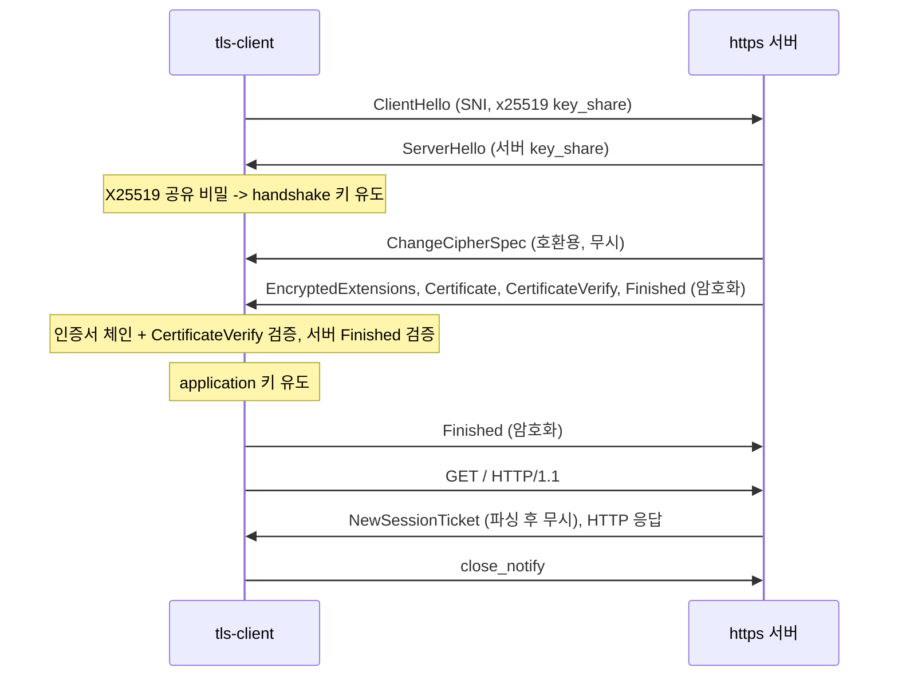
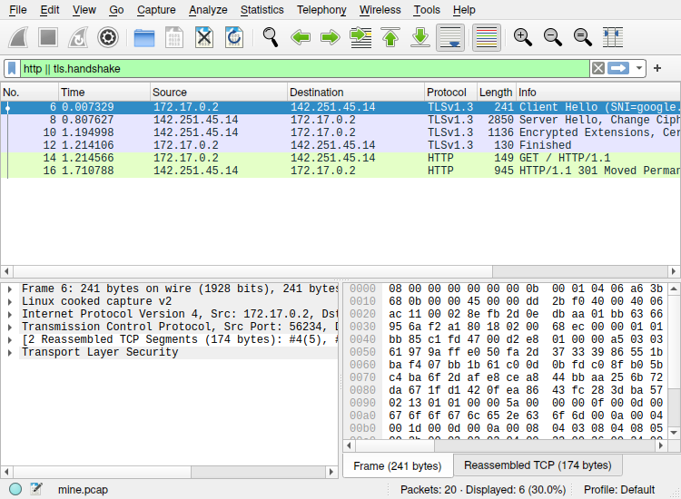

# tls-handshake

C로 직접 짠 TLS 1.3 클라이언트. `google.com` 같은 실제 https 사이트와 핸드셰이크를 끝까지 진행하고, 인증서를 검증한 뒤 `GET /` 응답을 받아 출력한다.

> **교육용 - 실서비스 사용 금지 / educational - not for production use.**
> 직접 짠 TLS/암호 코드는 프로덕션에 쓰면 안 된다 (SPEC N1). 프로그램도 시작할 때 이 배너를 항상 출력한다.

## 왜 만들었나

브라우저 주소창의 자물쇠(https) 뒤에서는 TLS라는 프로토콜이 서버와 키를 합의하고, 서버가 진짜인지 확인한 뒤, 이후 데이터를 암호화한다. 이 프로젝트는 그 과정이 "바이트 단위로 무엇을 하는지" 직접 구현하며 배우는 것이 목적이다.

원칙은 하나다. 암호 연산 자체(AES, SHA-256 등)는 검증된 라이브러리를 쓰고, 그 연산들을 엮는 프로토콜 로직은 전부 직접 작성한다.

## 주요 기능

직접 작성한 부분:

- **레코드 층** - TLS 데이터 단위(5바이트 헤더 + 본문) 읽기/쓰기, 메시지가 레코드 여러 개로 쪼개지거나 한 레코드에 여러 개 담겨 와도 재조립
- **ClientHello / ServerHello** - 첫 인사 메시지를 바이트 단위로 조립, 서버 응답 파싱과 협상 방어 (제시 안 한 암호군 선택 시 종료, HelloRetryRequest 감지 시 명시 에러)
- **키 스케줄** - HKDF로 공유 비밀에서 트래픽 키/IV/nonce 유도. RFC 8448 테스트 벡터와 비트 단위 일치
- **레코드 암호화** - AES-128-GCM 레코드 보호의 TLS 프레이밍 (AAD, nonce, TLSInnerPlaintext)
- **핸드셰이크 상태 머신** - 메시지 순서 강제, 서버/클라이언트 Finished HMAC 검증
- **인증서 검증** - 미니멀 X.509/DER 파서, PEM/base64 디코딩, 체인 서명 검증, 만료 확인, SAN(호스트네임) 매칭, CertificateVerify 서명 확인
- **애플리케이션 데이터** - GET 송신, 응답 출력, close_notify로 정리
- **키 로그** - `--keylog`로 SSLKEYLOGFILE 형식 시크릿 출력 (Wireshark 복호화용, 기본 꺼짐)

라이브러리에서 가져온 부분 (암호 원시 연산만, SPEC N3/C2/C3):

- **libsodium**: X25519(`crypto_scalarmult`), SHA-256, HMAC-SHA256
- **OpenSSL libcrypto**: AES-128-GCM 원시 AEAD, RSA-PSS/PKCS1, ECDSA 원시 서명 검증
  - `SSL_*`, `X509_*`, EVP HKDF 같은 고수준 API는 쓰지 않는다 (SPEC N4)

## 동작 방식

TLS 1.3 1-RTT 풀 핸드셰이크 흐름이다. 협상 조합은 TLS 1.3 + X25519 + `TLS_AES_128_GCM_SHA256` 하나로 고정되어 있다.



- 서버가 보낸 ServerHello 이후 메시지는 모두 암호화되어 온다. 클라이언트는 X25519로 만든 공유 비밀에서 handshake 키를 유도해 이를 푼다.
- 인증서 검증이 실패하면 애플리케이션 데이터를 보내기 전에 종료한다 (SPEC N2).
- 서버 Finished까지의 transcript hash로 application 키를 유도하고, 이후 GET 요청과 응답은 이 키로 보호된다.

## 결과: 내 클라이언트 vs curl

같은 서버에 보내는 ClientHello를 실제로 캡처해 비교했다 (macOS curl, SecureTransport/LibreSSL 백엔드). 전체 비교와 차이 이유는 [docs/wireshark-comparison.md](docs/wireshark-comparison.md) 참고.

| 항목 | `tls-client` | `curl` |
|---|---|---|
| ClientHello 캡처 크기 | 173바이트 | 301바이트 |
| 암호군 수 | 1 (`TLS_AES_128_GCM_SHA256`) | 49 |
| 확장 수 | 5 | 6 |
| supported_versions | TLS 1.3만 | TLS 1.3 ~ 1.0 |
| supported_groups | x25519만 | x25519, secp256r1, secp384r1, secp521r1 |
| ALPN | 없음 | `h2, http/1.1` |

내 클라이언트는 학습 범위에 맞춰 최소 조합만 제시한다.

## 스크린샷

`--keylog`로 뽑은 키 로그를 Wireshark에 지정해 내 클라이언트의 google.com 세션을 연 화면이다. 암호화된 Encrypted Extensions / Certificate / Finished와 `GET / HTTP/1.1`, `HTTP/1.1 301 Moved Permanently`가 평문으로 디코딩된다. 즉 핸드셰이크와 키 유도가 실제 서버와 맞게 동작했다는 증거다.



복호화 전 패킷 리스트(`docs/captures/mine.png`)와 curl 캡처(`docs/captures/curl.png`)도 같은 폴더에 있다.

## 빠른 시작

macOS + Homebrew 기준.

```sh
brew install libsodium openssl@3
make

# 신뢰 앵커(루트 CA) 번들 받기 - 직접 짠 PEM 로더가 읽는다
curl -sL https://curl.se/ca/cacert.pem -o cacert.pem

# 인증서 검증 포함 실행 (응답 본문은 stdout, 진행 로그는 stderr)
./tls-client google.com 443 --cafile cacert.pem
```

사용법:

```
./tls-client <host> [port] [--cafile <pem>] [--keylog <file>] [--insecure] [--dump-certs]
```

| 옵션 | 설명 |
|---|---|
| `port` | 기본값 `443` |
| `--cafile <pem>` | 신뢰 앵커 PEM 번들. 없으면 인증서를 검증할 수 없어 종료한다 (SPEC N2) |
| `--keylog <file>` | SSLKEYLOGFILE 형식으로 트래픽 시크릿 4줄을 append. 기본 꺼짐 (SPEC N5) |
| `--insecure` | 인증서 검증을 끄고 경고를 출력한다. 기본값이 절대 아니다 |
| `--dump-certs` | 서버가 보낸 인증서를 `cert_0.der`, `cert_1.der` ... 로 저장 |

Wireshark 복호화 절차는 [docs/wireshark-comparison.md](docs/wireshark-comparison.md#키-로그로-복호화-sslkeylogfile)에 있다.

## 테스트

```sh
make test        # 단위 테스트 빌드 + 실행, 전부 통과하면 "ALL TESTS PASSED"
make SAN=1 test  # ASan/UBSan 빌드로 테스트
make clean
```

소켓 없이 메모리에서만 도는 테스트다.

| 파일 | 내용 |
|---|---|
| `tests/test_record.c` | 레코드 헤더 파싱, 길이 제한, 양방향 단편화 재조립 |
| `tests/test_hello.c` | ServerHello 협상 방어 (비제시 암호군, HRR 감지), key_share 추출 |
| `tests/test_hkdf.c` | HKDF (RFC 5869 A.1), TLS 1.3 키 스케줄 (RFC 8448 Simple 1-RTT) |
| `tests/test_aead.c` | RFC 8448 암호화 레코드 복호화, 변조 감지, 서버 Finished 재현 |
| `tests/test_x509.c` | X.509 파싱, RSA 서명 검증, SAN 와일드카드 매칭, CertificateVerify (RSA-PSS) |

ECDSA 체인 전체 검증과 중간 CA 누락 체인 거부는 실서버 실행으로 확인한다.

## 완료 조건

- [x] 실제 https 서버(google.com, cloudflare.com)와 1-RTT 풀 핸드셰이크 성공
- [x] 서버/클라이언트 Finished 검증, application traffic key로 GET 송신 및 응답 수신
- [x] 인증서 체인 서명(ECDSA 리프 + RSA 경로) / 만료 / SAN / CertificateVerify 검증
- [x] RFC 8448 "Simple 1-RTT Handshake" 키 스케줄 벡터 비트 단위 일치 (단위 테스트)
- [x] 레코드 단편화 양방향 재조립, ChangeCipherSpec 무시, NewSessionTicket 파싱 후 무시
- [x] `--keylog`로 SSLKEYLOGFILE 형식 출력, close_notify 송신 후 정리
- [x] Wireshark 비교 문서와 캡처 스크린샷 (`docs/`)

## 프로젝트 구조

```
src/
  main.c                       진입점, 옵션 파싱
  int.h buf reader util        빅엔디언 정수 / 가변 버퍼 / 커서 파서 / 공용 유틸, 배너
  net record handshake_buf     TCP, 레코드 읽기/쓰기, 핸드셰이크 메시지 재조립
  hello                        ClientHello 조립 / ServerHello 파싱
  hkdf keysched                HKDF, 키 스케줄, 트래픽 키/nonce/Finished
  aead                         AES-128-GCM 레코드 보호
  handshake tls alert          상태 머신, 연결 상태, alert 처리
  der x509 pem verify          인증서 파싱과 검증
  appdata                      애플리케이션 데이터, keylog, close_notify
tests/                         단위 테스트 + RFC 8448 벡터(vec_aead.h)
docs/
  SRS.md SDS.md                요구사항 명세, 설계 명세
  wireshark-comparison.md      ClientHello 비교, 키 로그 복호화 절차
  captures/                    Wireshark 스크린샷, 원본 pcap
.planning/                     SPEC.md, 단계별 plan
```

## 더 읽을거리

- [docs/SRS.md](docs/SRS.md) - 요구사항 명세
- [docs/SDS.md](docs/SDS.md) - 설계 명세: 구성도, 시퀀스, 자료구조와 바이트 형식, 키 스케줄, 모듈
- [docs/wireshark-comparison.md](docs/wireshark-comparison.md) - curl과의 ClientHello 비교, 키 로그 복호화
- [.planning/SPEC.md](.planning/SPEC.md) - 요구사항, must-NOT 규칙, 범위 경계
- [.planning/plans/](.planning/plans/) - 구현 단계별 학습 가이드 (레코드 층 ~ 애플리케이션 데이터)

## 확장 후보 (범위 외)

- **ML-KEM 하이브리드 (X25519MLKEM768)**: 양자내성 하이브리드 키 교환. `key_share` 확장이 그룹을 바꿀 수 있도록 짜여 있어, 하이브리드 그룹과 공유 비밀 결합만 추가하면 붙는다. 완료 후 확장 후보로만 기재 (SPEC 경계).
