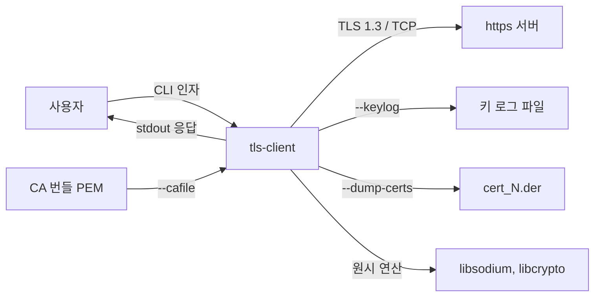
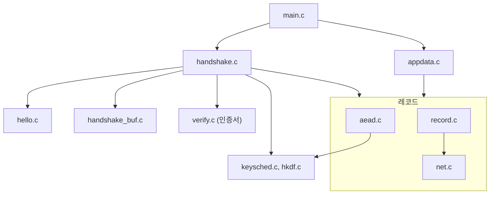
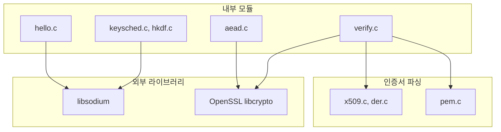
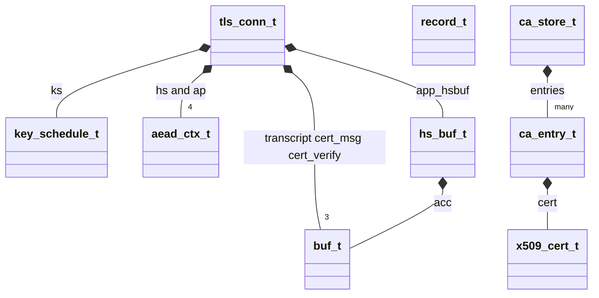
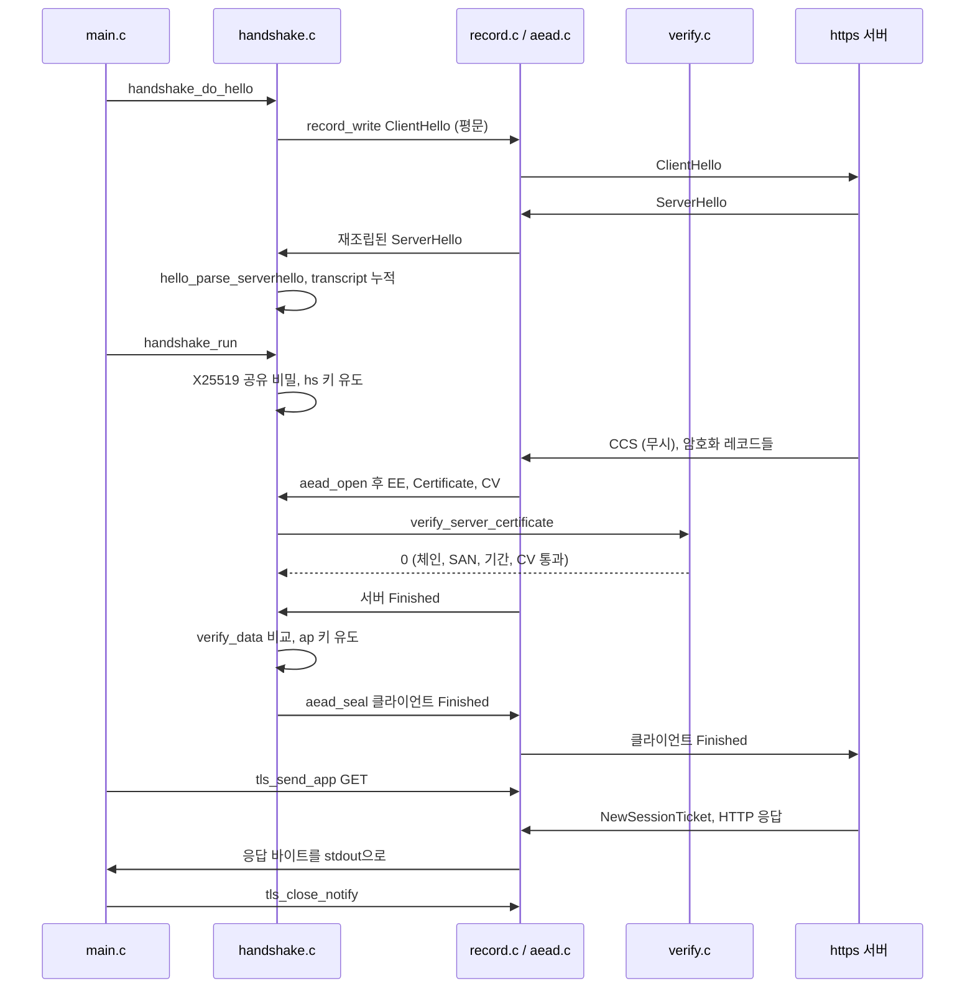
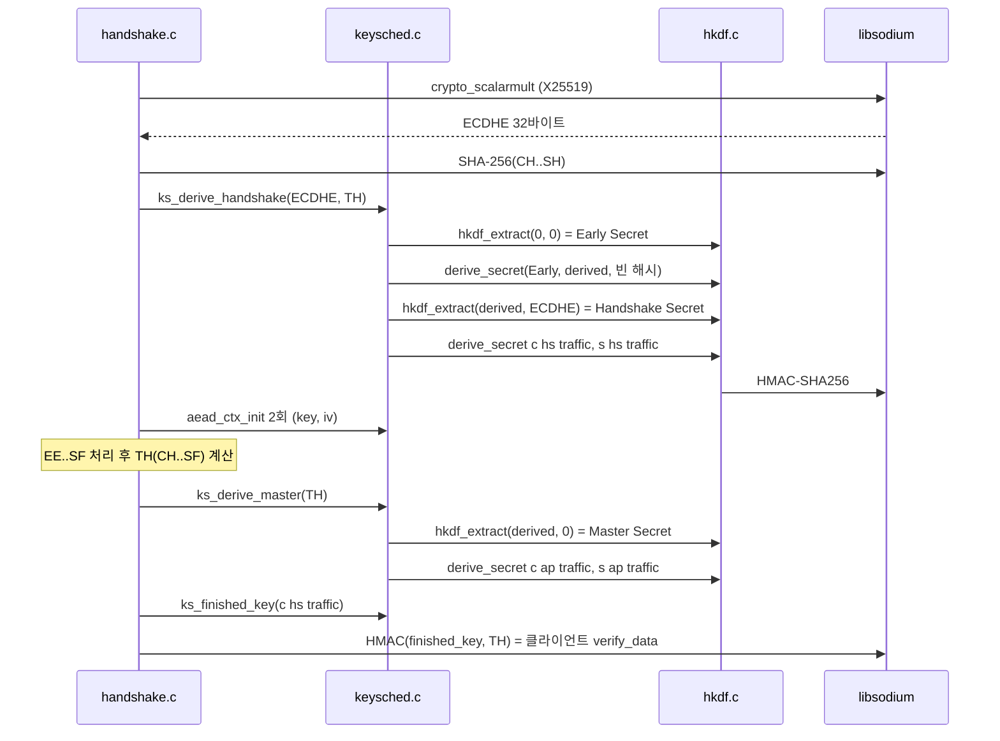
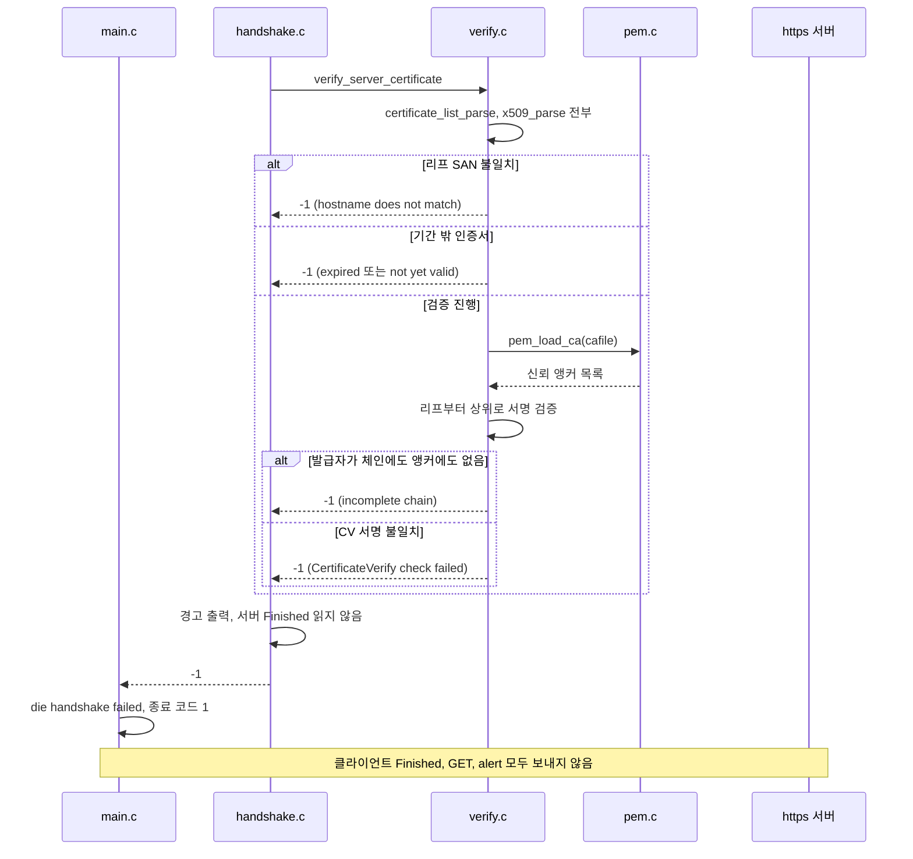
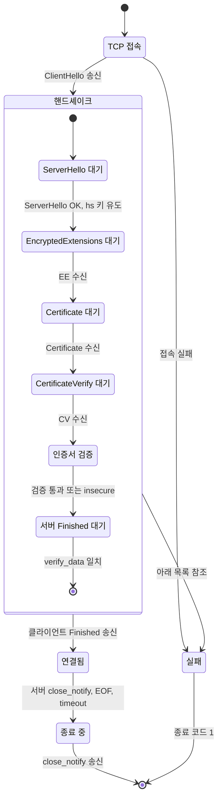
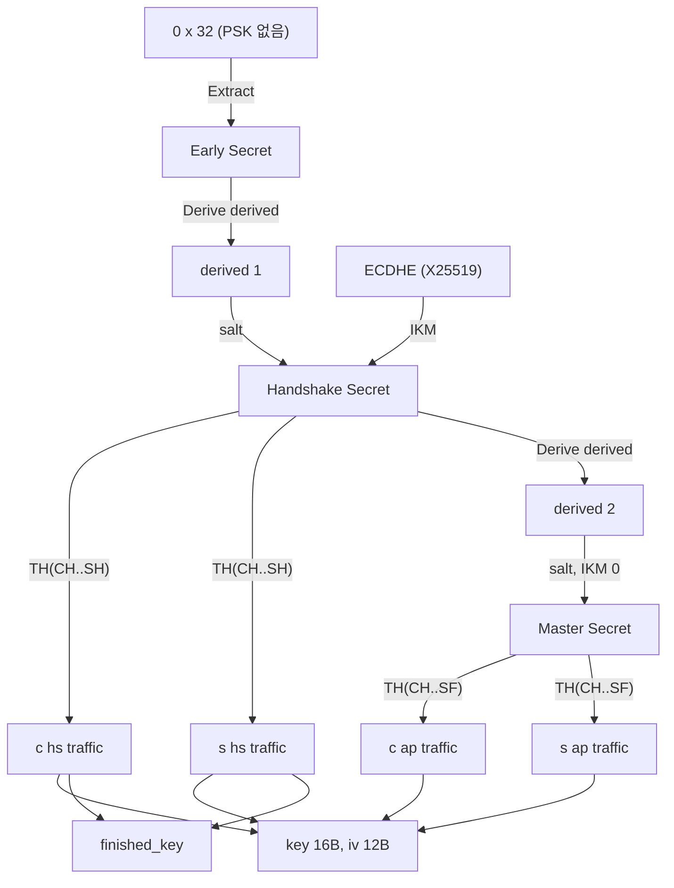

# tls-handshake 소프트웨어 설계 명세서 (SDS)

| 문서 | 버전 | 작성일 | 기준 표준 |
|---|---|---|---|
| tls-handshake SDS | 1.0 | 2026-11-18 | IEEE 1016-2009 |

> 교육용 - 실서비스 사용 금지 / educational - not for production use

## 1. 소개

### 1.1 목적

이 문서는 TLS 1.3 클라이언트 `tls-client`의 설계를 설명한다. 요구사항은 [SRS.md](SRS.md)에 있고, 이 문서는 그 요구사항을 어떤 모듈, 자료구조, 흐름으로 구현했는지 다룬다.

### 1.2 범위

`src/`의 C 코드 전체(레코드 층, ClientHello/ServerHello, 키 스케줄, AEAD 레코드 보호, 핸드셰이크 상태 머신, 인증서 검증, 애플리케이션 데이터, 키 로그)와 `tests/`의 단위 테스트를 다룬다. 범위 밖 기능은 [SRS 부록 B](SRS.md#부록-b-범위-외-항목)를 따른다.

### 1.3 용어 정의

[SRS 1.4 용어 정의](SRS.md#14-용어-정의)를 따른다. 이 문서에서 추가로 쓰는 표기:

| 표기 | 뜻 |
|---|---|
| TH(A..B) | 메시지 A부터 B까지의 transcript hash (SHA-256) |
| CH, SH, EE, CV, SF, CF | ClientHello, ServerHello, EncryptedExtensions, CertificateVerify, 서버 Finished, 클라이언트 Finished |
| hs / ap | handshake 트래픽 / application 트래픽 |

### 1.4 참고 문서

| 문서 | 내용 |
|---|---|
| [SRS.md](SRS.md) | 요구사항 명세 |
| [README.md](../README.md) | 개요, 빠른 시작, 핸드셰이크 개요 시퀀스 |
| [wireshark-comparison.md](wireshark-comparison.md) | curl과의 ClientHello 비교, 키 로그 복호화 절차 |
| RFC 8446 | TLS 1.3 (4절 핸드셰이크, 5절 레코드, 7.1절 키 스케줄) |
| RFC 8448 | 테스트 벡터 ("Simple 1-RTT Handshake") |
| RFC 5869 | HKDF |
| RFC 5280 | X.509 인증서 구조 |
| RFC 6125 | 호스트네임 매칭 |

## 2. 설계 이해관계자와 관심사

| 이해관계자 | 관심사 | 다루는 뷰 |
|---|---|---|
| 학습자 (개발자 본인) | 핸드셰이크 순서, 키가 어디서 나오는지, 바이트 형식 | 3.4 정보, 3.6 상호작용, 3.7 상태, 3.8 알고리즘 |
| 코드 리뷰어 | 모듈 경계, 직접 구현과 라이브러리의 경계, 오류 처리 | 3.2 구성, 3.3 논리, 4 설계 근거, 5 오류 처리 |
| 보안 관점 검토자 | 인증서 검증 게이트 위치, 비밀 값 노출, 실패 시 동작 | 3.6 상호작용 (실패 경로), 3.9 자원, 5 오류 처리 |
| 사용자 (CLI 실행자) | 옵션, 출력, 종료 코드 | 3.1 컨텍스트, 3.5 인터페이스 |

## 3. 설계 뷰

### 3.1 컨텍스트 뷰

`tls-client`는 단일 프로세스, 단일 연결 CLI다. 외부와는 TCP 소켓, 파일, 두 암호 라이브러리로만 연결된다.



### 3.2 구성 뷰

모듈 호출 관계:



인증서 파싱과 외부 라이브러리 의존:



| 구성 요소 | 역할 | 기술 |
|---|---|---|
| `main.c` | 옵션 파싱, TCP 접속, 핸드셰이크 -> 키 로그 -> GET -> 수신 -> close_notify 순서 구동 | C11 |
| `handshake.c` | 상태 머신. 레코드 디스패치, 메시지 순서 강제, 서버 Finished 검증, 클라이언트 Finished 송신, 인증서 검증 게이트 | 직접 구현 |
| `hello.c` | X25519 키 쌍, random, session_id 생성. ClientHello 조립, ServerHello 파싱과 협상 방어 | 직접 구현 + libsodium 난수/X25519 |
| `appdata.c` | 애플리케이션 데이터 송신, 수신 루프, close_notify, 키 로그 출력 | 직접 구현 |
| `record.c` | 레코드 헤더 파싱, 레코드 읽기/쓰기, 길이 상한 검사 | 직접 구현 |
| `handshake_buf.c` | 레코드 경계와 무관한 핸드셰이크 메시지 재조립 버퍼 | 직접 구현 |
| `aead.c` | AES-128-GCM 레코드 보호의 TLS 프레이밍 (AAD, nonce, TLSInnerPlaintext) | 직접 구현 + `EVP_aes_128_gcm` |
| `net.c` | TCP 접속, `read_full` / `write_full`, 수신 timeout | POSIX 소켓 |
| `keysched.c`, `hkdf.c` | HKDF, HKDF-Expand-Label, Derive-Secret, 키 스케줄, nonce, Finished 계산 | 직접 구현 + libsodium SHA-256/HMAC |
| `verify.c` | 체인 구성과 서명 검증, 유효 기간, SAN 매칭, CertificateVerify | 직접 구현 + `EVP_DigestVerify` |
| `x509.c`, `der.c` | DER TLV 커서, 인증서 필드 추출 | 직접 구현 |
| `pem.c` | PEM 블록 추출, base64 디코딩, 신뢰 앵커 저장소 | 직접 구현 |
| `alert.c` | alert level/description 이름 변환과 출력 | 직접 구현 |
| `buf.c`, `reader.c`, `int.h`, `util.c` | 가변 버퍼와 길이 back-patch, 경계 검사 커서, 빅엔디언 정수, 배너/경고/hex | 직접 구현 |
| libsodium | X25519, SHA-256, HMAC-SHA256, 난수, 상수 시간 비교 | 외부 라이브러리 |
| OpenSSL libcrypto | AES-128-GCM 원시 AEAD, RSA/ECDSA 원시 서명 검증 | 외부 라이브러리 |

### 3.3 논리 뷰

주요 구조체와 포함 관계다. 모든 상태는 `tls_conn_t` 하나에 모인다.



#### `tls_conn_t` (`src/tls.h`) - 연결 상태

| 필드 | 타입 | 설명 |
|---|---|---|
| `fd` | `int` | TCP 소켓 |
| `host` | `const char *` | SNI와 호스트네임 검증 대상 |
| `client_priv`, `client_pub` | `uint8_t[32]` | 클라이언트 X25519 임시 키 쌍 |
| `server_pub`, `have_server_pub` | `uint8_t[32]`, `int` | ServerHello key_share에서 꺼낸 서버 공개키 |
| `session_id`, `session_id_len` | `uint8_t[32]`, `uint8_t` | legacy_session_id (미들박스 호환용 32바이트 난수) |
| `client_random`, `server_random` | `uint8_t[32]` | Hello random. client_random은 키 로그에도 쓰인다 |
| `cipher_suite` | `uint16_t` | 협상 결과. 항상 `0x1301` |
| `transcript` | `buf_t` | 핸드셰이크 메시지 누적 (4바이트 헤더 포함, 레코드 헤더 제외) |
| `ks` | `key_schedule_t` | 유도된 시크릿 전체 |
| `rd_hs`, `wr_hs` | `aead_ctx_t` | handshake 트래픽 보호 (서버 수신 / 클라이언트 송신) |
| `rd_app`, `wr_app` | `aead_ctx_t` | application 트래픽 보호 |
| `cert_msg`, `cert_verify` | `buf_t` | Certificate, CertificateVerify 본문 (헤더 제외) |
| `th_cert`, `have_th_cert` | `uint8_t[32]`, `int` | TH(CH..Certificate). CertificateVerify 검증 입력 |
| `app_hsbuf` | `hs_buf_t` | 핸드셰이크 후 오는 메시지(NewSessionTicket) 재조립 |
| `handshake_done` | `int` | 클라이언트 Finished 송신 완료 표시 |
| `dump_certs`, `cafile`, `insecure`, `keylog` | 옵션 값 | `--dump-certs`, `--cafile`, `--insecure`, `--keylog` |

#### 그 밖의 구조체

| 구조체 (파일) | 필드 | 설명 |
|---|---|---|
| `key_schedule_t` (`keysched.h`) | `early_secret`, `handshake_secret`, `master_secret`, `client_hs_traffic`, `server_hs_traffic`, `client_ap_traffic`, `server_ap_traffic` | 각 32바이트 시크릿 |
| `aead_ctx_t` (`aead.h`) | `key[16]`, `iv[12]`, `seq` (`uint64_t`) | 방향별 레코드 보호 상태. 레코드마다 `seq` 증가 |
| `record_t` (`record.h`) | `type`, `version`, `hdr[5]`, `body`, `len` | 수신 레코드 1개. `hdr`는 받은 그대로 보관해 AAD로 쓴다 |
| `hs_buf_t` (`handshake_buf.h`) | `acc` (`buf_t`), `consumed` | 재조립 누적 버퍼와 소비 오프셋. push 때 소비분을 앞으로 당긴다 |
| `buf_t` (`buf.h`) | `data`, `len`, `cap` | 가변 바이트 버퍼. `buf_begin_uN` / `buf_end_uN`으로 길이 필드 back-patch |
| `rd_t` (`reader.h`) | `p`, `len`, `off`, `err` | 경계 검사 커서. 범위를 넘으면 `err`가 고정되고, 끝에서 `rd_ok`로 한 번 확인 |
| `der_tlv_t` (`der.h`) | `tag`, `hdr`, `content`, `content_len`, `total_len` | DER TLV 하나. 원본 바이트 범위를 가리킨다 |
| `x509_cert_t` (`x509.h`) | `tbs`, `issuer`, `subject`, `spki`, `sig_alg_oid`, `sig_value` (각 포인터 + 길이), `not_before`, `not_after`, `dns[64]`, `dns_count`, `is_ca` | 검증에 필요한 필드만. 모두 원본 DER 안을 가리킨다 |
| `ca_store_t` / `ca_entry_t` (`pem.h`) | `entries`, `count`, `cap` / `der`, `der_len`, `cert` | 신뢰 앵커 저장소. 파싱 가능한 인증서만 보관 |

### 3.4 정보 뷰

데이터베이스는 없다. 이 절은 직접 다루는 바이트 형식을 정리한다. 모든 정수는 빅엔디언이다.

#### TLS 레코드 (RFC 8446 5.1)

| 오프셋 | 크기 | 필드 | 값 |
|---|---|---|---|
| 0 | 1 | type | 20 CCS, 21 alert, 22 handshake, 23 application_data |
| 1 | 2 | legacy_record_version | 송신 시 항상 `0x0303`, 수신 시 무시 |
| 3 | 2 | length | 최대 16640 (2^14 + 256). 초과하면 거부 |
| 5 | length | fragment | 평문 또는 암호문 |

#### 핸드셰이크 메시지 (RFC 8446 4)

| 오프셋 | 크기 | 필드 | 값 |
|---|---|---|---|
| 0 | 1 | msg_type | 1 CH, 2 SH, 4 NewSessionTicket, 8 EE, 11 Certificate, 15 CV, 20 Finished |
| 1 | 3 | length | body 길이 |
| 4 | length | body | 메시지 본문 |

transcript에는 이 4바이트 헤더 + body가 그대로 쌓인다.

#### ClientHello (`hello_build_clienthello`)

| 필드 | 크기 | 값 |
|---|---|---|
| legacy_version | 2 | `0x0303` |
| random | 32 | libsodium 난수 |
| legacy_session_id | 1 + 32 | 32바이트 난수 |
| cipher_suites | 2 + 2 | `0x1301` 하나 |
| legacy_compression_methods | 1 + 1 | null(0) 하나 |
| extensions | 2 + 80 + len(host) | 아래 5개 |

| 확장 (type) | 크기 | 내용 |
|---|---|---|
| server_name (0) | 9 + len(host) | host_name 하나 |
| supported_groups (10) | 8 | x25519 (`0x001d`) |
| signature_algorithms (13) | 14 | `0x0403`, `0x0804`, `0x0805`, `0x0806` |
| supported_versions (43) | 7 | `0x0304` 하나 (1바이트 목록 길이) |
| key_share (51) | 42 | x25519 공개키 32바이트 |

레코드 전체 크기는 164 + len(host) 바이트다. host가 `127.0.0.1`(9바이트)일 때 173바이트로, [wireshark-comparison.md](wireshark-comparison.md)의 캡처 크기와 같다.

#### 암호화 레코드 (RFC 8446 5.2, `aead.c`)

| 부분 | 내용 |
|---|---|
| 바깥 헤더 | type 23, version `0x0303`, length = 내부 평문 길이 + 1 + 16 |
| AAD | 바깥 헤더 5바이트 그대로 (암호문 길이가 들어 있다) |
| nonce | `iv` 12바이트의 뒤 8바이트에 64비트 `seq`를 빅엔디언으로 XOR |
| 암호문 | AES-128-GCM(TLSInnerPlaintext) |
| tag | 16바이트 |
| TLSInnerPlaintext | content + 실제 content type 1바이트 + zero padding. 송신 시 padding 없음, 수신 시 뒤의 0을 건너뛰고 마지막 non-zero 바이트를 type으로 읽는다 |

#### HkdfLabel (`hkdf_expand_label`)

| 필드 | 크기 | 값 |
|---|---|---|
| length | 2 | 출력 길이 L |
| label | 1 + n | `"tls13 "` + label (`derived`, `c hs traffic`, `s hs traffic`, `c ap traffic`, `s ap traffic`, `key`, `iv`, `finished`) |
| context | 1 + m | transcript hash (Derive-Secret) 또는 빈 값 |

#### Certificate와 CertificateVerify 본문

| 메시지 | 구조 |
|---|---|
| Certificate | request_context(1 + n, 서버는 빈 값) + certificate_list(3 + n) = [cert_data(3 + n) + extensions(2 + n)] 반복. 확장은 무시 |
| CertificateVerify | scheme(2) + signature(2 + n) |
| CV 서명 대상 | `0x20` 64개 + `"TLS 1.3, server CertificateVerify"` + `0x00` + TH(CH..Certificate) |

#### 키 로그 (NSS Key Log, `keylog_write`)

```
CLIENT_HANDSHAKE_TRAFFIC_SECRET <client_random hex> <secret hex>
SERVER_HANDSHAKE_TRAFFIC_SECRET <client_random hex> <secret hex>
CLIENT_TRAFFIC_SECRET_0 <client_random hex> <secret hex>
SERVER_TRAFFIC_SECRET_0 <client_random hex> <secret hex>
```

### 3.5 인터페이스 뷰

#### CLI

```
./tls-client <host> [port] [--cafile <pem>] [--keylog <file>] [--insecure] [--dump-certs]
```

| 인자 | 기본값 | 동작 |
|---|---|---|
| `host` | 필수 | 접속 대상, SNI, 호스트네임 검증 대상 |
| `port` | `443` | 두 번째 위치 인자 |
| `--cafile <pem>` | 없음 | 신뢰 앵커 PEM 번들. 없고 `--insecure`도 없으면 검증 단계에서 종료 |
| `--keylog <file>` | 꺼짐 | 핸드셰이크 완료 후 시크릿 4줄 append |
| `--insecure` | 꺼짐 | 인증서와 CertificateVerify 검증을 건너뛰고 경고 출력 |
| `--dump-certs` | 꺼짐 | 서버 인증서를 `cert_0.der` ... 로 저장 (최대 16개) |

| 출력 | 내용 |
|---|---|
| stdout | 복호화한 HTTP 응답 바이트 그대로 |
| stderr | 시작 배너, 진행 로그, `warning:` 경고, `error:` 치명 오류, alert 이름 |
| 종료 코드 | 0 성공, 1 실패 (`die`), 2 사용법 오류 |

#### 모듈 간 주요 함수

| 모듈 | 함수 | 반환 |
|---|---|---|
| `handshake.h` | `handshake_do_hello`, `handshake_run`, `certificate_list_parse` | 0 / -1, 인증서 수 |
| `hello.h` | `hello_gen_keys`, `hello_build_clienthello`, `hello_parse_serverhello` | 0 / -1 / -2 (HRR) |
| `record.h` | `record_parse_header`, `record_read`, `record_write` | 0 / -1 |
| `handshake_buf.h` | `hsbuf_push`, `hsbuf_next` | 1 메시지 있음 / 0 바이트 더 필요 |
| `keysched.h` | `ks_derive_handshake`, `ks_derive_master`, `ks_traffic_keys`, `ks_finished_key`, `ks_nonce`, `finished_verify` | `finished_verify`만 0 / -1 |
| `hkdf.h` | `hkdf_extract`, `hkdf_expand`, `hkdf_expand_label`, `derive_secret` | 없음 |
| `aead.h` | `aead_ctx_init`, `aead_open`, `aead_seal` | 0 / -1 |
| `verify.h` | `verify_server_certificate`, `verify_cert_signature`, `verify_certificate_verify`, `hostname_match` | 0 / -1, `hostname_match`는 1 / 0 |
| `appdata.h` | `tls_send_app`, `tls_recv_loop`, `tls_close_notify`, `keylog_write` | 0 / -1 |

### 3.6 상호작용 뷰

README에 서버와의 메시지 흐름 개요가 있다. 여기서는 모듈 단위로 본다.

#### 풀 핸드셰이크 (정상 경로)



ServerHello까지는 평문이고, 그 뒤 서버 메시지는 `rd_hs`로 복호화한다. 인증서 검증 게이트는 서버 Finished를 읽기 전에 있다. 클라이언트 Finished는 `wr_hs`로, GET부터는 `wr_app`으로 보호한다.

#### 키 스케줄 유도



ECDHE 공유 비밀은 handshake 시크릿 유도 직후 `sodium_memzero`로 지운다. 유도 공식 전체는 [3.8 알고리즘 뷰](#38-알고리즘-뷰)에 있다.

#### 인증서 검증 실패



실패하면 실패 단계와 이유를 `warning: verify: ...`로 남기고 종료한다. 애플리케이션 데이터는 절대 나가지 않는다 (N2). 서버에 alert를 보내지 않고 프로세스가 끝나며 소켓이 닫힌다.

### 3.7 상태 동적 뷰

`handshake_do_hello`와 `handshake_run`은 순차 코드지만, 각 단계는 다음 메시지를 기다리는 상태로 볼 수 있다. `expect_message`가 기대한 type이 아니면 실패로 간다.



핸드셰이크 중 실패로 가는 경우: ServerHello 대기에서 HRR, 협상 실패, alert. EncryptedExtensions, Certificate, CertificateVerify, 서버 Finished 대기에서 순서 위반, AEAD 인증 실패, alert 수신. 인증서 검증 실패. 서버 Finished의 verify_data 불일치.

### 3.8 알고리즘 뷰

#### 키 스케줄 (RFC 8446 7.1, `keysched.c`)



단계:

1. `Early Secret = HKDF-Extract(salt = 0, IKM = 0 x 32)`
2. `derived 1 = Derive-Secret(Early Secret, "derived", SHA-256(""))`
3. `Handshake Secret = HKDF-Extract(salt = derived 1, IKM = ECDHE)`
4. `c/s hs traffic = Derive-Secret(Handshake Secret, "c hs traffic" / "s hs traffic", TH(CH..SH))`
5. `derived 2 = Derive-Secret(Handshake Secret, "derived", SHA-256(""))`
6. `Master Secret = HKDF-Extract(salt = derived 2, IKM = 0 x 32)`
7. `c/s ap traffic = Derive-Secret(Master Secret, "c ap traffic" / "s ap traffic", TH(CH..SF))`
8. 각 트래픽 시크릿에서 `key = Expand-Label(secret, "key", "", 16)`, `iv = Expand-Label(secret, "iv", "", 12)`
9. `finished_key = Expand-Label(secret, "finished", "", 32)`, `verify_data = HMAC(finished_key, TH)`
   - 서버 Finished: `s hs traffic`, TH(CH..CV)
   - 클라이언트 Finished: `c hs traffic`, TH(CH..SF)

`Derive-Secret(s, label, h) = HKDF-Expand-Label(s, label, h, 32)`이고, HKDF-Expand는 `T(i) = HMAC(PRK, T(i-1) || info || i)`를 이어 붙여 L바이트를 만든다 (`hkdf.c`).

#### 레코드 복호화 (`aead_open`)

1. 본문이 16바이트보다 짧으면 실패
2. 뒤 16바이트를 tag로, 나머지를 암호문으로 나눈다
3. `nonce = iv XOR seq` (seq는 뒤 8바이트에 빅엔디언)
4. AAD = 받은 레코드 헤더 5바이트로 AES-128-GCM 복호화, tag 불일치면 실패
5. 성공하면 `seq++`
6. 평문 끝에서 0을 건너뛰고, 마지막 non-zero 바이트를 content type으로 꺼낸다. 전부 0이면 실패

#### 체인 구성 (`verify_server_certificate`)

1. Certificate 메시지에서 DER 목록을 꺼내 전부 파싱
2. 리프 SAN dNSName 중 하나가 호스트네임과 맞는지 확인
3. 받은 모든 인증서의 `notBefore <= now <= notAfter` 확인
4. CA 번들 로드 후, 리프부터 i = 0, 1, ... 순서로:
   - 현재 인증서의 subject와 SPKI가 신뢰 앵커와 같으면 신뢰 완료 (루트가 체인에 같이 온 경우)
   - 다음 인증서의 subject가 현재의 issuer와 같으면, 그 인증서에 cA가 있는지 확인하고 그 공개키로 서명 검증 후 한 단계 위로
   - 아니면 issuer와 subject가 같은 신뢰 앵커를 찾아 그 공개키로 서명 검증하고 신뢰 완료. 못 찾으면 불완전 체인으로 실패
5. 리프 공개키로 CertificateVerify 서명 확인

이름 비교는 DER 바이트 그대로 비교한다 (`x509_name_equal`).

#### 호스트네임 매칭 (`hostname_match`)

- 패턴이 `*.`로 시작하면 호스트의 첫 레이블을 떼고 나머지를 대소문자 무시로 비교한다. 첫 레이블 하나만 대체하므로 `*.example.com`은 `a.b.example.com`이나 `example.com`과 맞지 않는다
- 아니면 길이가 같고 대소문자 무시로 같아야 한다

### 3.9 자원 뷰

| 자원 | 값 | 위치 |
|---|---|---|
| 스레드 | 단일 스레드, 연결 1개 | `main.c` |
| 네트워크 | TCP, 기본 포트 443, IPv4/IPv6 (`AF_UNSPEC`) | `net.c` |
| 수신 timeout | 응답 수신 루프 10초, 끝나면 해제 | `appdata.c` (`tls_recv_loop`) |
| 레코드 상한 | 본문 16640바이트 | `record.h` (`TLS_RECORD_MAX_FRAGMENT`) |
| 체인 길이 | 최대 10개 | `verify.c` (`MAX_CHAIN`) |
| SAN 항목 | 인증서당 최대 64개, 초과분 무시 | `x509.h` (`X509_MAX_SAN`) |
| 인증서 저장 | 최대 16개 | `handshake.c` (`dump_certificate_list`) |
| 요청 버퍼 | 512바이트 | `main.c` |
| 메모리 | 레코드 본문, transcript, 재조립 버퍼, CA 저장소는 힙. CA 번들은 검증 때 파일 전체를 읽는다 | `record.c`, `buf.c`, `pem.c` |
| 파일 | 읽기: CA 번들. 쓰기: 키 로그 (append), `cert_N.der` | `pem.c`, `appdata.c`, `handshake.c` |

## 4. 설계 근거

각 결정의 배경과 결과는 [ADR](adr/README.md)에 기록되어 있습니다.

| 결정 | 대안 | 선택 이유 |
|---|---|---|
| 암호 원시 연산만 라이브러리, 프로토콜 로직은 직접 구현 | 전부 직접 구현 / OpenSSL `SSL_*` 사용 | 원시 연산 직접 구현은 위험하고 학습 목표 밖. 고수준 API는 배울 부분을 가린다 (N3, N4) |
| AES-128-GCM은 OpenSSL `EVP_aes_128_gcm` | libsodium | libsodium의 AES-GCM은 256비트 전용이라 `TLS_AES_128_GCM_SHA256`에 쓸 수 없다 |
| 서명 검증은 OpenSSL 원시 `EVP_DigestVerify`, 공개키는 직접 파싱한 SPKI에서 생성 | `X509_verify_cert` | 서명 대상 바이트 구성과 DER 파싱을 직접 하라는 제약 (C3, N4) |
| 협상 조합 1개 고정 (TLS 1.3, X25519, `0x1301`) | 다중 암호군/그룹 협상 | 상태 머신과 키 유도의 정확성이 목적. ClientHello와 협상 방어가 단순해진다 |
| signature_algorithms에 검증 가능한 4종만 제시 | 넓게 제시 | 서버가 고른 CertificateVerify 서명을 반드시 검증할 수 있게 한다 |
| tbsCertificate, issuer/subject를 원본 DER 범위로 보관 | 파싱 후 재직렬화 | 재직렬화는 서명 불일치의 고전적 원인. 이름 비교도 바이트 비교로 단순화 |
| 레코드 층과 핸드셰이크 재조립 버퍼 분리 | 레코드 1개 = 메시지 1개 가정 | 실서버의 Certificate는 여러 레코드에 걸치고, 한 레코드에 여러 메시지가 온다 |
| 경계 검사 커서 `rd_t`의 고정 에러 플래그 | 필드마다 길이 검사 | 파서 코드가 짧아지고, 끝에서 `rd_ok` 한 번으로 범위 초과를 잡는다 |
| `buf_begin_uN` / `buf_end_uN` 길이 back-patch | 길이를 미리 계산 | 중첩 길이 필드가 많은 ClientHello 조립을 읽기 쉽게 한다 |
| 인증서 검증 게이트를 서버 Finished 처리 전에 둠 | Finished 후 검증 | 검증 실패 시 클라이언트 Finished와 애플리케이션 데이터가 나가지 않는 것이 코드 순서로 보장된다 (N2) |
| `--insecure`는 명시 옵션 + 경고, `--cafile` 없으면 실패 | 기본 검증 끔 | 검증 활성이 기본값이어야 한다 (N2) |
| HRR은 감지 후 명시 에러로 종료 | 재시도 구현 | 대상 사이트가 X25519를 지원해 실익이 없다 |
| 중간 CA 누락 시 실패, AIA 추적 없음 | AIA로 받아오기 | 범위 외. 서명, 기간, 이름 검증에 집중 |
| NewSessionTicket은 파싱 후 무시 | 세션 재개 구현 | 범위 외. 수신 루프에서 재조립만 하고 버린다 |
| 키 로그는 `--keylog`일 때만, client_random 기준 NSS 형식 | 항상 출력 / 환경 변수 | 비밀 값 기본 비노출 (N5), Wireshark가 바로 읽는 형식 |
| Finished 비교에 `sodium_memcmp` | `memcmp` | 상수 시간 비교 |

## 5. 오류 처리와 엣지 케이스

| 상황 | 동작 |
|---|---|
| host 누락, 알 수 없는 옵션 | 사용법 출력, 종료 코드 2 |
| TCP 접속 실패 | `error: TCP connect ... failed`, 종료 코드 1 |
| 레코드 length > 16640 | `record_read` 실패, 연결 실패로 종료 |
| 레코드 읽기 중 EOF | 핸드셰이크 중이면 실패, 응답 수신 중이면 루프 종료 후 close_notify 송신 |
| 메시지가 여러 레코드에 걸침 / 한 레코드에 여러 메시지 | 재조립 버퍼가 완전한 메시지 단위로 꺼낸다 |
| ServerHello 전 서버 alert | level/description 이름 출력, 실패 |
| ServerHello가 HRR (고정 random) | `HelloRetryRequest is not supported` 경고, 실패 |
| supported_versions 없음 또는 `0x0304` 아님 | 실패 |
| 제시하지 않은 암호군, non-null compression | 실패 |
| key_share 그룹이 x25519 아님, 길이 32 아님, key_share 없음 | 실패 |
| ServerHello의 알 수 없는 확장 | 무시 |
| 키 유도 전 암호화 레코드 | `encrypted record before handshake keys established`, 실패 |
| CCS 레코드 (type 20) | 무시하고 계속 |
| AEAD tag 불일치, 본문 16바이트 미만, 내부 평문 전부 0 | `AEAD decryption/authentication failed`, 실패 |
| 핸드셰이크 중 예상 밖 내부 content type | 경고만 출력하고 계속 |
| 알 수 없는 바깥 레코드 type | 버리고 계속 |
| 핸드셰이크 메시지 순서 위반 | `handshake out of order: expected type X, got Y`, 실패 |
| 암호화 중 서버 alert | 이름 출력, 실패 |
| `--cafile` 없음 (`--insecure`도 없음) | `no --cafile trust anchors given`, 실패 |
| `--insecure` | 체인과 CertificateVerify 검증을 모두 건너뛰고 경고 출력. 서버 Finished 검증은 그대로 한다 |
| 인증서 0개, DER 파싱 실패 | 실패 |
| 리프 SAN 불일치 | `hostname ... does not match`, 실패 |
| 인증서 기간 전/후 | `not yet valid` / `has expired`, 실패. 신뢰 앵커 자체의 기간은 검사하지 않는다 |
| CA 번들을 못 읽거나 파싱 가능한 인증서가 없음 | `could not load CA bundle`, 실패 |
| CA 번들 안의 파싱 불가 인증서 | 건너뛴다 |
| 중간 인증서에 cA 없음 | `lacks basicConstraints cA`, 실패 |
| 발급자를 체인과 앵커 어디서도 못 찾음 | `incomplete chain ... (AIA not followed)`, 실패 |
| 체인에 루트가 함께 옴 | subject와 SPKI가 앵커와 같으면 거기서 신뢰 완료 |
| 지원하지 않는 서명 알고리즘 OID / CV scheme | 실패 |
| 인증서의 RSASSA-PSS OID | 파라미터를 읽지 않고 SHA-256으로 가정 |
| CertificateVerify 형식 오류, 서명 불일치 | 실패 |
| 서버가 인증서 11개 이상 전송 | 알려진 결함: `MAX_CHAIN`(10) 초과를 거부하지 않아 스택 배열 범위 밖을 읽는다 (ASan으로 재현) |
| 서버 Finished verify_data 불일치 | `server Finished verify_data mismatch`, 실패 |
| 검증 실패 일반 | 클라이언트 Finished, GET, alert를 보내지 않고 종료 코드 1 |
| 핸드셰이크 후 NewSessionTicket | 재조립 후 크기만 stderr에 출력하고 무시 |
| 응답 수신 중 서버 close_notify 또는 fatal alert | 이름 출력 후 루프 종료, close_notify 송신 |
| 응답 수신 10초 무응답 | 루프 종료, close_notify 송신 |
| 응답 레코드 복호화 실패 | 경고 후 루프 종료 |
| 키 로그 파일 열기 실패 | 경고만 출력하고 계속 |

## 6. 요구사항-설계 추적

| ID | 담당 설계 요소 |
|---|---|
| FR-1 | 3.2 `record.c`, `handshake_buf.c`, `net.c` / 3.4 TLS 레코드, 핸드셰이크 메시지 |
| FR-2 | 3.2 `hello.c` / 3.4 ClientHello / 3.6 풀 핸드셰이크 / 3.7 WaitSH |
| FR-3 | 3.2 `keysched.c`, `hkdf.c` / 3.4 HkdfLabel / 3.6 키 스케줄 유도 / 3.8 키 스케줄 |
| FR-4 | 3.2 `handshake.c`, `aead.c`, `alert.c` / 3.4 암호화 레코드 / 3.7 상태 머신 / 3.8 레코드 복호화 |
| FR-5 | 3.2 `verify.c`, `x509.c`, `der.c`, `pem.c` / 3.4 Certificate, CV / 3.6 인증서 검증 실패 / 3.8 체인 구성, 호스트네임 매칭 |
| FR-6 | 3.2 `appdata.c`, `main.c` / 3.6 풀 핸드셰이크 / 3.7 Connected, Closing |
| FR-7 | 3.2 `appdata.c` (`keylog_write`) / 3.4 키 로그 / [wireshark-comparison.md](wireshark-comparison.md) |
| FR-8 | 3.2 `handshake.c` (`dump_certificate_list`) / 3.5 CLI |
| NFR-1 | 3.9 수신 timeout |
| NFR-2 | 3.4 TLS 레코드 / 3.9 레코드 상한 |
| NFR-3, NFR-4, NFR-5 | 3.5 CLI 출력 / `util.c` |
| NFR-6 | 3.8 키 스케줄 / `tests/test_hkdf.c`, `tests/test_aead.c` |
| NFR-7 | `Makefile` (`SAN=1`) |
| NFR-8 | 4 설계 근거 (검증 게이트, `--insecure`) / 3.6 인증서 검증 실패 |
| NFR-9 | 3.4 키 로그 / 4 설계 근거 |
| NFR-10 | `keysched.c` (`finished_verify`) |
| NFR-11 | 3.4 ClientHello (서버 호환 최소 확장) |
| NFR-12 | `tests/` |

### 테스트 구성

| 층 | 파일 | 다루는 범위 |
|---|---|---|
| 단위 (메모리 전용) | `tests/test_record.c`, `test_hello.c`, `test_hkdf.c`, `test_aead.c`, `test_x509.c` | 레코드 층, 협상 방어, 키 스케줄 벡터, AEAD와 Finished, X.509와 CertificateVerify. RFC 8448 벡터는 `tests/vec_aead.h` |
| 실서버 실행 | `docs/captures/mine.pcap`, `*.png` | google.com 1-RTT 완주, ECDSA 리프 체인 검증, GET/응답, close_notify |

실행은 `make test` (전부 통과 시 `ALL TESTS PASSED`), `make SAN=1 test` (ASan/UBSan).
