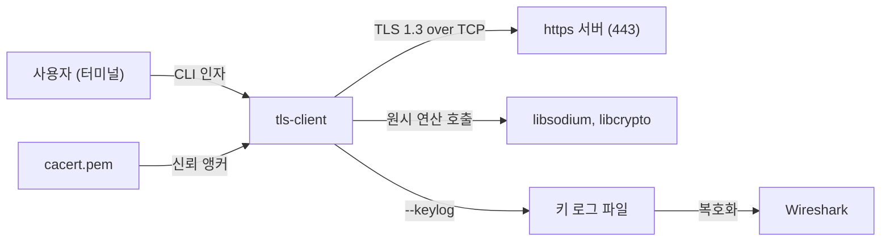

# tls-handshake 소프트웨어 요구사항 명세서 (SRS)

| 문서 | 버전 | 작성일 | 기준 표준 |
|---|---|---|---|
| tls-handshake SRS | 1.0 | 2026-11-18 | ISO/IEC/IEEE 29148:2018 |

> 교육용 - 실서비스 사용 금지 / educational - not for production use

## 1. 소개

### 1.1 목적

이 문서는 C로 직접 작성한 TLS 1.3 클라이언트 `tls-client`의 요구사항을 정의한다.
프로젝트의 목표는 https가 바이트 단위로 무엇을 하는지 이해하는 것이다. 암호 원시 연산은 검증된 라이브러리를 쓰고, 이를 엮는 프로토콜 로직은 전부 직접 작성한다.
설계는 [SDS.md](SDS.md)에서 다룬다.

### 1.2 범위

`tls-client`가 하는 일:

- TLS 1.3 1-RTT 풀 핸드셰이크 (클라이언트 측)
- 협상 조합 고정: TLS 1.3 + X25519 + `TLS_AES_128_GCM_SHA256`
- 레코드 층 (평문/암호문, 단편화 재조립)
- ClientHello/ServerHello와 필수 확장 5개 (SNI, supported_versions, supported_groups, key_share, signature_algorithms)
- HKDF 키 스케줄 (RFC 8448 벡터로 검증)
- 인증서 체인 검증 (미니멀 X.509 DER 파싱, 체인 서명, 유효 기간, SAN 매칭, CertificateVerify)
- 하드코딩 `GET /` 송신과 응답 출력
- SSLKEYLOGFILE 형식 키 로그 옵션과 Wireshark 비교 문서

하지 않는 일(서버 구현, TLS 1.2 이하, 세션 재개 등)은 [부록 B](#부록-b-범위-외-항목)에 이유와 함께 정리한다.

### 1.3 제품 개요

#### 1.3.1 제품 관점

독립 실행형 CLI 프로그램이다. 사용자가 호스트를 지정하면 TCP로 https 서버에 붙어 핸드셰이크를 하고, 로컬 CA 번들로 서버 인증서를 검증한다. 암호 원시 연산은 libsodium과 OpenSSL libcrypto를 호출한다.



#### 1.3.2 제품 기능

- TLS 레코드 읽기/쓰기와 핸드셰이크 메시지 재조립
- ClientHello 조립, ServerHello 파싱과 협상 방어 (비제시 암호군, HRR 감지)
- HKDF 기반 키 스케줄과 레코드별 nonce 계산
- AES-128-GCM 레코드 보호 (AAD, nonce, TLSInnerPlaintext 처리)
- 핸드셰이크 상태 머신 (메시지 순서 강제, Finished 검증)
- 인증서 체인, 유효 기간, SAN, CertificateVerify 검증
- GET 송신, 응답 출력, close_notify 종료
- 키 로그 출력 (`--keylog`), 서버 인증서 저장 (`--dump-certs`)

#### 1.3.3 사용자 특성

| 사용자 | 특성과 사용 상황 |
|---|---|
| 학습자 (개발자 본인) | C와 네트워크 기초를 알고, TLS 1.3 핸드셰이크와 키 스케줄을 코드로 따라가며 학습 |
| 코드 리뷰어 / 채용 담당자 | 직접 구현한 프로토콜 로직과 검증 근거(테스트, 캡처)를 확인 |
| 네트워크 분석 학습자 | Wireshark 사용법을 알고, `--keylog` 출력으로 자기 세션을 복호화해 관찰 |

#### 1.3.4 제한 사항

| 항목 | 내용 |
|---|---|
| 언어 | C11 (`-std=c11 -Wall -Wextra -Wpedantic`) |
| 플랫폼 | macOS, Homebrew로 라이브러리 설치. 빌드는 `Makefile` |
| 의존성 | libsodium, OpenSSL 3 libcrypto (원시 연산만) |
| 신뢰 앵커 | PEM CA 번들 파일 (예: curl `cacert.pem`) |
| 실행 환경 | 대상 서버의 TCP 포트(기본 443)에 접속 가능한 네트워크 |
| 용도 | 교육용 전용. 실서비스 사용 금지 |

### 1.4 용어 정의

| 용어 | 설명 |
|---|---|
| 레코드 (record) | TLS 전송 단위. 5바이트 헤더(type, legacy_version, length) + 본문 |
| 핸드셰이크 메시지 | msg_type(1) + length(3) + body. 레코드 경계와 무관하게 쪼개지거나 묶여서 온다 |
| ClientHello / ServerHello | 클라이언트와 서버의 첫 인사 메시지. 버전, 암호군, 키 교환 값을 협상한다 |
| HRR (HelloRetryRequest) | 서버가 다른 키 교환 그룹으로 다시 보내라고 요구하는 ServerHello. 고정 random 값으로 식별 |
| X25519 | 타원곡선 Diffie-Hellman 키 교환. 양쪽 공개키로 공유 비밀을 만든다 |
| HKDF | HMAC 기반 키 유도 함수 (RFC 5869). Extract와 Expand 두 단계 |
| 키 스케줄 | 공유 비밀에서 Early / Handshake / Master Secret과 트래픽 시크릿을 유도하는 절차 (RFC 8446 7.1) |
| transcript hash | 지금까지 주고받은 핸드셰이크 메시지 전체의 SHA-256. 키 유도와 서명 검증의 입력 |
| AEAD | 암호화와 무결성 검증을 함께 하는 방식. 여기서는 AES-128-GCM |
| TLSInnerPlaintext | 암호화 레코드 내부 구조. 본문 + 실제 content type 1바이트 + zero padding |
| Finished | 핸드셰이크 무결성 확인 메시지. transcript hash에 대한 HMAC |
| CertificateVerify | 서버가 리프 인증서 개인키로 transcript hash에 서명한 메시지 |
| SAN (subjectAltName) | 인증서가 유효한 호스트네임 목록 (dNSName) |
| 신뢰 앵커 (trust anchor) | 미리 신뢰하는 루트 CA 인증서. PEM 번들 파일에서 로드 |
| CCS (ChangeCipherSpec) | TLS 1.3에서는 미들박스 호환용으로만 오는 레코드(type 20). 무시한다 |
| NewSessionTicket | 세션 재개용 티켓. 핸드셰이크 후 도착하며 여기서는 파싱 후 무시 |
| close_notify | 연결 종료를 알리는 alert |
| SSLKEYLOGFILE | 트래픽 시크릿을 기록하는 NSS Key Log 형식. Wireshark가 이 파일로 세션을 복호화한다 |

## 2. 참고 문서

| 문서 | 내용 |
|---|---|
| [SDS.md](SDS.md) | 설계 명세 (구성, 자료구조, 시퀀스, 키 스케줄) |
| [README.md](../README.md) | 개요, 빠른 시작, 테스트 실행 |
| [wireshark-comparison.md](wireshark-comparison.md) | curl과의 ClientHello 비교, 키 로그 복호화 절차 |
| [captures/](captures/) | Wireshark 스크린샷 3장, 원본 pcap 2개 |
| RFC 8446 | TLS 1.3 (기준 문서) |
| RFC 8448 | TLS 1.3 예제 트레이스 ("Simple 1-RTT Handshake" 테스트 벡터) |
| RFC 5869 | HKDF |
| RFC 5280 | X.509 인증서 프로필 |
| RFC 6125 | 호스트네임 매칭 |
| NSS Key Log Format | SSLKEYLOGFILE 형식 |

## 3. 요구사항

### 3.1 기능 요구사항

#### FR-1 TLS 레코드 층

| 설명 | 우선순위 | 출처 | 검증 방법 |
|---|---|---|---|
| 시스템은 TLS 레코드를 읽고 쓰며, 레코드 경계와 무관하게 핸드셰이크 메시지 단위로 재조립해야 한다 | 필수 | SPEC R1 | 시험 |

수용 기준:
- 레코드 헤더(type, legacy_version, length)를 파싱하고 length만큼 본문을 정확히 읽는다
- 본문 길이가 2^14 + 256(16640)을 초과하는 레코드는 에러로 거부한다
- 핸드셰이크 메시지 1개가 레코드 2개 이상에 걸친 입력을 재조립한다
- 레코드 1개에 담긴 핸드셰이크 메시지 2개 이상을 분리한다
- TCP 수신이 임의 바이트 경계에서 끊겨도(부분 read) 동작한다

#### FR-2 ClientHello 조립과 ServerHello 파싱

| 설명 | 우선순위 | 출처 | 검증 방법 |
|---|---|---|---|
| 시스템은 실제 서버가 수락하는 ClientHello를 바이트 단위로 조립하고, ServerHello에서 협상 결과를 확인해야 한다 | 필수 | SPEC R2 | 시험, 시연 |

수용 기준:
- ClientHello에 SNI, supported_versions, supported_groups, key_share, signature_algorithms 확장 5개를 넣는다
- google.com:443에 보내면 서버가 alert 없이 ServerHello로 응답한다
- ServerHello의 supported_versions가 0x0304(TLS 1.3)가 아니면 에러로 종료한다
- 서버가 제시하지 않은 암호군을 고르면 에러로 종료한다
- 서버 key_share가 x25519가 아니거나 길이가 32바이트가 아니면 에러로 종료한다
- HelloRetryRequest를 받으면 "HRR 미지원" 명시 에러로 종료한다
- ClientHello 바이트가 Wireshark에서 오류 없이 디코딩된다

#### FR-3 키 스케줄

| 설명 | 우선순위 | 출처 | 검증 방법 |
|---|---|---|---|
| 시스템은 X25519 공유 비밀에서 HKDF 기반 TLS 1.3 키 스케줄을 직접 구현해 트래픽 키를 유도해야 한다 | 필수 | SPEC R3 | 시험 |

수용 기준:
- HKDF-Extract / HKDF-Expand / HKDF-Expand-Label / Derive-Secret을 직접 구현한다 (HMAC-SHA256 원시 연산만 라이브러리)
- RFC 8448 "Simple 1-RTT Handshake" 벡터의 Early / Handshake / Master Secret, 트래픽 시크릿, 키, IV와 비트 단위로 일치한다
- transcript hash가 메시지 순서대로 누적되며, 유도 시점별 값이 벡터와 일치한다
- 시퀀스 번호와 IV의 XOR로 레코드별 nonce를 만든다

#### FR-4 핸드셰이크 완주와 암호화 레코드 처리

| 설명 | 우선순위 | 출처 | 검증 방법 |
|---|---|---|---|
| 시스템은 서버의 암호화 메시지를 복호화·파싱하고, 서버 Finished를 검증한 뒤 클라이언트 Finished를 보내 핸드셰이크를 마쳐야 한다 | 필수 | SPEC R4 | 시험, 시연 |

수용 기준:
- 암호화 레코드의 AAD(레코드 헤더), nonce, 내부 content type과 zero padding을 올바르게 처리한다
- 변조된 암호화 레코드는 인증 실패로 거부한다
- EncryptedExtensions -> Certificate -> CertificateVerify -> Finished 순서를 강제하고, 어긋나면 에러로 종료한다
- 서버 Finished의 verify_data를 직접 계산해 비교하고, 불일치 시 종료한다
- 호환용 ChangeCipherSpec 레코드(type 20)를 무시하고 계속 진행한다
- 핸드셰이크 후 도착하는 NewSessionTicket을 파싱해 소비하고 무시한다
- 서버 alert 수신 시 level과 description을 이름으로 출력하고 종료한다

#### FR-5 인증서 체인 검증

| 설명 | 우선순위 | 출처 | 검증 방법 |
|---|---|---|---|
| 시스템은 서버 인증서 체인을 직접 파싱·검증하고, 실패 시 애플리케이션 데이터 없이 종료해야 한다 | 필수 | SPEC R5 | 시험, 시연 |

수용 기준:
- 미니멀 X.509 DER 파서로 tbsCertificate 원본 바이트, issuer/subject, validity, SAN, subjectPublicKeyInfo, basicConstraints, signatureAlgorithm을 추출한다
- 신뢰 앵커를 PEM 번들(`--cafile`)에서 로드하며, PEM/base64 디코딩은 직접 구현한다
- 리프부터 신뢰 앵커까지 각 인증서 서명을 상위 인증서 공개키로 확인한다
- 중간 인증서는 basicConstraints cA가 켜져 있어야 한다
- notBefore/notAfter를 현재 시각과 비교해 기간 밖 인증서를 거부한다
- SAN dNSName과 호스트네임을 대소문자 무시로 비교하며, 단일 레이블 와일드카드(`*.example.com`)만 허용한다
- 중간 CA가 누락된 체인은 검증 실패로 종료한다 (AIA 추적 없음)
- CertificateVerify 서명 대상 바이트(공백 64개 + 컨텍스트 문자열 + 0x00 + transcript hash)를 직접 구성해 확인한다
- 실패 시 어느 단계에서 왜 실패했는지 출력한다
- `--insecure`로 검증을 끌 수 있지만 기본값은 검증 활성이고, 끈 경우 경고를 출력한다

#### FR-6 애플리케이션 데이터 송수신

| 설명 | 우선순위 | 출처 | 검증 방법 |
|---|---|---|---|
| 시스템은 핸드셰이크 후 애플리케이션 트래픽 키로 GET 요청을 보내고, 복호화한 응답을 stdout에 그대로 출력해야 한다 | 필수 | SPEC R6 | 시연 |

수용 기준:
- `GET / HTTP/1.1` 요청(Host, Connection: close)을 암호화해 보낸다
- google.com에 대해 `HTTP/1.1`로 시작하는 응답 바이트가 stdout에 출력된다
- google.com 외 실사이트 1곳 이상(예: cloudflare.com)에서도 성공한다
- 서버 close_notify 또는 EOF에서 수신을 멈추고, close_notify alert를 보낸 뒤 연결을 정리한다

#### FR-7 키 로그와 Wireshark 비교 문서

| 설명 | 우선순위 | 출처 | 검증 방법 |
|---|---|---|---|
| 시스템은 키 로그 옵션으로 세션 복호화를 지원하고, 내 클라이언트와 curl의 ClientHello를 실제 캡처로 비교한 문서를 갖춰야 한다 | 필수 | SPEC R7 | 시연, 검사 |

수용 기준:
- `--keylog <file>`을 줄 때만 SSLKEYLOGFILE 형식 4줄(handshake / application 트래픽 시크릿, 양방향)을 append 한다
- Wireshark에서 키 로그로 애플리케이션 데이터 복호화에 성공한 화면이 있다
- 내 클라이언트와 curl 캡처 스크린샷이 각 1장 이상 있다
- ClientHello 필드 비교표와 차이점 3가지 이상의 이유 설명이 있다

#### FR-8 서버 인증서 저장 (디버그)

| 설명 | 우선순위 | 출처 | 검증 방법 |
|---|---|---|---|
| 시스템은 `--dump-certs`를 주면 서버가 보낸 인증서를 `cert_0.der`, `cert_1.der` ... 로 저장해야 한다 | 선택 | 코드 (`src/handshake.c`), plan 04 디버그 경로 | 검사 |

수용 기준:
- 옵션이 없으면 파일을 만들지 않는다
- 최대 16개까지 DER 원본 그대로 저장한다

### 3.2 성능 요구사항

| ID | 요구사항 | 목표치 | 검증 방법 |
|---|---|---|---|
| NFR-1 | 응답 수신 중 무한 대기 방지 | 수신 루프 소켓 timeout 10초 | 검사 |
| NFR-2 | 레코드 크기 상한 | 본문 16640바이트(2^14 + 256) 이하만 수락 | 시험 |

성능(처리량, 지연) 목표치는 SPEC에 정의되어 있지 않다. 교육용 단일 연결 도구이므로 측정 대상이 아니다.

### 3.3 사용성 요구사항

| ID | 요구사항 | 목표치 | 검증 방법 |
|---|---|---|---|
| NFR-3 | 출력 분리 | 응답 본문은 stdout, 진행 로그와 경고는 stderr | 검사 |
| NFR-4 | 실패 이유 고지 | 협상, 인증서, Finished 실패 시 단계와 이유를 `warning:` / `error:` 줄로 출력 | 검사 |
| NFR-5 | 용도 고지 | 시작할 때 "교육용 - 실서비스 사용 금지" 배너 출력 | 검사 |

### 3.4 인터페이스 요구사항

| 종류 | 인터페이스 | 요구사항 |
|---|---|---|
| 사용자 | CLI | `./tls-client <host> [port] [--cafile <pem>] [--keylog <file>] [--insecure] [--dump-certs]`. port 기본 `443`. 알 수 없는 옵션이나 host 누락 시 사용법 출력 후 종료 코드 2 |
| 사용자 | 종료 코드 | 성공 0, 실패 1 (`die`), 사용법 오류 2 |
| 소프트웨어 | libsodium | X25519 `crypto_scalarmult`, `crypto_hash_sha256`, `crypto_auth_hmacsha256_*`, `randombytes_buf`, `sodium_memcmp` |
| 소프트웨어 | OpenSSL libcrypto | `EVP_aes_128_gcm` 원시 AEAD, `EVP_DigestVerify` 원시 서명 검증, `EVP_PKEY_fromdata`로 공개키 객체 생성 |
| 소프트웨어 | 파일 | 입력: PEM CA 번들. 출력: 키 로그(append), `cert_N.der` |
| 통신 | TCP | `getaddrinfo` 기반 IPv4/IPv6 접속, 기본 포트 443 |
| 통신 | TLS 1.3 | RFC 8446 레코드/핸드셰이크 형식, `TLS_AES_128_GCM_SHA256`, X25519, 서명 알고리즘 0x0403 / 0x0804 / 0x0805 / 0x0806 제시 |
| 통신 | HTTP | `GET / HTTP/1.1` 한 건, 응답은 파싱하지 않음 |

### 3.5 논리 데이터 요구사항

데이터베이스는 없다. 모든 상태는 연결 1개의 메모리 안에만 있고, 프로세스가 끝나면 사라진다.

| 데이터 | 보관 범위 | 요구사항 |
|---|---|---|
| 핸드셰이크 transcript | 연결 동안 메모리 | ClientHello부터 클라이언트 Finished까지 메시지(4바이트 헤더 포함, 레코드 헤더 제외)를 순서대로 보관 |
| 키 스케줄 시크릿 | 연결 동안 메모리 | Early / Handshake / Master Secret, 4개 트래픽 시크릿 |
| 레코드 보호 상태 | 연결 동안 메모리 | 방향별 key, IV, 64비트 시퀀스 번호 |
| 인증서 메시지 | 검증 시점까지 메모리 | Certificate, CertificateVerify 본문과 Transcript-Hash(CH..Certificate) |
| 신뢰 앵커 | 검증 동안 메모리 | PEM 번들에서 읽은 DER과 파싱 결과 |
| 키 로그 | 사용자 지정 파일 | `--keylog`일 때만 4줄 append. 저장소에 커밋하지 않음 |

자료구조와 바이트 형식의 상세는 [SDS 3.3, 3.4](SDS.md#33-논리-뷰)에 있다.

### 3.6 설계 제약

- 암호 원시 연산만 라이브러리를 쓴다. 프로토콜 로직(레코드 층, 상태 머신, 키 스케줄, HKDF-Expand-Label, X.509/DER 파싱, PEM/base64 디코딩, 서명 대상 바이트 구성)은 직접 작성한다
- AES-128-GCM은 libsodium에 없으므로 OpenSSL libcrypto의 원시 AEAD를 쓴다
- RSA-PSS, RSA PKCS#1, ECDSA 서명 검증은 OpenSSL libcrypto의 원시 검증 API를 쓴다. 공개키 값은 직접 파싱한 SubjectPublicKeyInfo에서 꺼낸다
- tbsCertificate는 재직렬화하지 않고 원본 바이트 범위를 그대로 서명 검증에 쓴다
- 협상 조합은 TLS 1.3 + X25519 + `TLS_AES_128_GCM_SHA256` 하나로 고정한다
- `src/` 코드는 `-Wall -Wextra -Wpedantic`에서 경고가 없어야 한다

### 3.7 소프트웨어 시스템 속성

| ID | 속성 | 요구사항 | 검증 방법 |
|---|---|---|---|
| NFR-6 | 신뢰성 | 키 스케줄과 레코드 보호가 표준 벡터(RFC 5869 A.1, RFC 8448 Simple 1-RTT)와 비트 단위 일치 | 시험 |
| NFR-7 | 신뢰성 | ASan/UBSan 빌드(`make SAN=1 test`)에서 메모리 오류 없음 | 시험 |
| NFR-8 | 보안 | 인증서 검증 기본 활성. 끄려면 `--insecure` 명시, 사용 시 경고 출력 | 검사 |
| NFR-9 | 보안 | `--keylog` 없이는 트래픽 시크릿, 개인키를 어디에도 출력하지 않음 | 검사 |
| NFR-10 | 보안 | Finished verify_data 비교는 상수 시간(`sodium_memcmp`) | 검사 |
| NFR-11 | 이식성 | 실제 https 서버 2곳(google.com, cloudflare.com)과 상호 운용 | 시연 |
| NFR-12 | 유지보수성 | 단위 테스트는 소켓 없이 메모리에서만 실행 | 검사 |

### 3.8 금지 조건 (must-NOT)

- **N1**: 실서비스/프로덕션에 사용하지 않는다. README와 프로그램 시작 배너에 "교육용 - 실서비스 사용 금지" 문구가 있어야 한다.
- **N2**: 인증서 검증 실패 상태에서 애플리케이션 데이터를 보내지 않는다. 검증을 끄는 플래그의 기본값은 검증 활성이며, 끈 상태에서는 경고를 출력한다.
- **N3**: 암호 원시 연산(AES-GCM, SHA-256, HMAC, X25519, RSA/ECDSA 서명)을 직접 구현하지 않는다. 검증된 라이브러리를 쓴다.
- **N4**: 라이브러리의 고수준 TLS/X.509 API(`SSL_*`, `X509_verify_cert`, EVP HKDF KDF 등)로 프로토콜 로직을 대체하지 않는다.
- **N5**: 트래픽 시크릿, 개인키를 기본 동작으로 로그에 남기지 않는다. 키 로그는 `--keylog`일 때만 출력한다.

## 4. 검증

### 4.1 검증 방법

| 방법 | 내용 |
|---|---|
| 시험 | `tests/` 단위 테스트 5개. 소켓 없이 RFC 8448 벡터와 조작 입력으로 실행 |
| 시연 | 실서버(google.com) 실행을 Wireshark로 캡처한 `docs/captures/` (pcap, 스크린샷) |
| 검사 | 소스 코드와 문서 확인 |
| 분석 | 해당 없음 |

실행:

```sh
make test        # 단위 테스트 빌드 + 실행, 전부 통과하면 "ALL TESTS PASSED"
make SAN=1 test  # ASan/UBSan 빌드로 테스트
```

| 테스트 파일 | 검증 대상 |
|---|---|
| `tests/test_record.c` | 레코드 헤더 파싱, 길이 상한, 레코드 걸침, 한 레코드 여러 메시지, 1바이트씩 투입 |
| `tests/test_hello.c` | ServerHello 정상 파싱, 비제시 암호군, 잘못된 버전, HRR, 비 x25519 key_share, ClientHello 길이 필드 |
| `tests/test_hkdf.c` | HKDF (RFC 5869 A.1), 키 스케줄 전 단계 (RFC 8448), transcript hash, nonce XOR |
| `tests/test_aead.c` | RFC 8448 암호화 레코드 복호화, 변조 감지, 서버 Finished 일치/불일치, Certificate 목록 파싱 |
| `tests/test_x509.c` | X.509 파싱, RSA 자체 서명 검증과 변조 거부, SAN 와일드카드, RSA-PSS CertificateVerify와 transcript 변조 거부 |

### 4.2 요구사항 추적표

상태 기준: 저장소에 통과하는 테스트, 캡처, 문서 같은 근거가 있으면 충족, 코드만 있고 근거가 없으면 미검증.

| ID | 요구사항 | 구현 위치 | 검증 근거 | 상태 |
|---|---|---|---|---|
| FR-1 | 레코드 헤더 파싱, 길이 상한, 양방향 재조립, 부분 read | `src/record.c`, `src/handshake_buf.c`, `src/net.c` | `tests/test_record.c` | 충족 |
| FR-2 | ClientHello 조립, ServerHello 협상 방어, HRR 감지 | `src/hello.c`, `src/handshake.c` | `tests/test_hello.c`, `docs/captures/mine.png` (Wireshark 디코딩, ServerHello 수신) | 충족 |
| FR-3 | HKDF, 키 스케줄, transcript hash, nonce | `src/hkdf.c`, `src/keysched.c` | `tests/test_hkdf.c` | 충족 |
| FR-4 | 암호화 레코드 처리, 변조 거부, 서버 Finished 검증 | `src/aead.c`, `src/keysched.c`, `src/handshake.c` | `tests/test_aead.c` | 충족 |
| FR-4 | 실서버 핸드셰이크 완주, CCS 무시 | `src/handshake.c` | `docs/captures/mine.pcap`, `mine.png`, `decrypted.png` (CCS 이후 Finished와 애플리케이션 데이터까지 진행) | 충족 |
| FR-4 | 메시지 순서 위반 거부, alert 이름 출력, NewSessionTicket 무시 | `src/handshake.c`, `src/alert.c`, `src/appdata.c` | 단위 테스트나 저장된 실행 로그 없음 | 미검증 |
| FR-5 | X.509 파싱, 서명 검증, SAN 와일드카드, CertificateVerify | `src/der.c`, `src/x509.c`, `src/pem.c`, `src/verify.c` | `tests/test_x509.c`, `mine.pcap` (`--cafile` 실행이 GET까지 진행) | 충족 |
| FR-5 | 만료 인증서 거부 | `src/verify.c` | 단위 테스트 없음 (`test_x509.c`는 validity 파싱만 확인) | 미검증 |
| FR-5 | 중간 CA 누락 체인 거부, 실패 단계 출력 | `src/verify.c` | 단위 테스트나 저장된 실행 로그 없음 | 미검증 |
| FR-6 | google.com GET 송신, 응답 수신, close_notify | `src/appdata.c`, `src/main.c` | `docs/captures/decrypted.png` (`GET / HTTP/1.1`, `301 Moved Permanently`), `wireshark-comparison.md`의 tshark 결과 (Close Notify #18) | 충족 |
| FR-6 | 두 번째 실사이트 (cloudflare.com) 성공 | `src/main.c` | 저장소에 캡처나 로그 없음 | 미검증 |
| FR-7 | 키 로그, 캡처 비교 문서 | `src/appdata.c`, `docs/wireshark-comparison.md` | `docs/captures/` 스크린샷 3장 + pcap 2개, 비교표, 차이점 5가지 | 충족 |
| FR-8 | 서버 인증서 저장 | `src/handshake.c` (`dump_certificate_list`) | 테스트 없음 | 미검증 |
| NFR-1 | 수신 timeout 10초 | `src/appdata.c`, `src/net.c` | 테스트 없음 | 미검증 |
| NFR-2 | 레코드 크기 상한 | `src/record.c` | `tests/test_record.c` (16640 수락, 초과 거부) | 충족 |
| NFR-3 | stdout / stderr 분리 | `src/appdata.c`, `src/util.c` | 테스트 없음 | 미검증 |
| NFR-4 | 실패 이유 고지 | `src/hello.c`, `src/verify.c`, `src/handshake.c` | `tests/test_hello.c` 실행 시 협상 실패 경고 출력. 인증서 실패 경로는 근거 없음 | 미검증 |
| NFR-5 | 시작 배너 | `src/util.c` (`print_banner`) | 소스와 `README.md`에 문구 존재 | 충족 |
| NFR-6 | 표준 벡터 일치 | `src/hkdf.c`, `src/keysched.c`, `src/aead.c` | `tests/test_hkdf.c`, `tests/test_aead.c` | 충족 |
| NFR-7 | ASan/UBSan 클린 | `Makefile` (`SAN=1`) | 저장된 실행 결과 없음 | 미검증 |
| NFR-8 | 검증 기본 활성, `--insecure` 경고 | `src/handshake.c` (`verify_certificate_chain`) | 테스트 없음 | 미검증 |
| NFR-9 | 비밀 값 비노출 | `src/appdata.c` (`keylog_write`) | 테스트 없음 | 미검증 |
| NFR-10 | Finished 상수 시간 비교 | `src/keysched.c` (`finished_verify`) | 소스에서 `sodium_memcmp` 사용 확인 | 충족 |
| NFR-11 | 실서버 2곳 상호 운용 | 전체 | google.com은 `mine.pcap`, cloudflare.com은 근거 없음 | 미검증 |
| NFR-12 | 메모리 전용 단위 테스트 | `tests/` | 테스트 소스에 소켓 호출 없음 (`tls_conn_init(&c, -1, ...)`) | 충족 |
| N1 | 교육용 고지 | `src/util.c`, `README.md` | 소스와 README에 문구 존재 | 충족 |
| N2 | 검증 실패 시 애플리케이션 데이터 미송신 | `src/handshake.c` (검증 게이트가 서버 Finished 처리 전) | 실패 경로 테스트 없음 | 미검증 |
| N3 | 암호 원시 연산 직접 구현 금지 | `src/hkdf.c`, `src/aead.c`, `src/verify.c` | 소스 검사: libsodium `crypto_*`, OpenSSL `EVP_*` 원시 연산만 호출 | 충족 |
| N4 | 고수준 TLS/X.509 API 금지 | `src/` 전체 | 소스 검사: `SSL_*`, `X509_*`, EVP KDF 호출 없음 | 충족 |
| N5 | 키 로그는 `--keylog`일 때만 | `src/appdata.c` | 테스트 없음 | 미검증 |

## 부록 A. 가정과 의존성

- 대상 서버는 TLS 1.3, X25519, `TLS_AES_128_GCM_SHA256`을 지원한다고 가정한다 (google.com, cloudflare.com 기준). 지원하지 않으면 HRR이나 협상 실패로 종료한다
- 대상 서버의 CertificateVerify는 클라이언트가 제시한 서명 알고리즘 4종(ECDSA P-256 SHA-256, RSA-PSS-RSAE SHA-256/384/512) 중 하나를 쓴다고 가정한다
- 서버는 완전한 체인(리프 + 중간 CA)을 보낸다고 가정한다. 누락 시 AIA로 받아오지 않는다
- 시스템 시계가 정확하다고 가정한다. 유효 기간 검사는 `time(NULL)`을 쓴다
- 신뢰 앵커 번들(`cacert.pem`)은 사용자가 별도로 받아 둔다
- libsodium과 OpenSSL 3는 Homebrew(`brew --prefix`) 경로에 설치되어 있다고 가정한다

## 부록 B. 범위 외 항목

| 항목 | 이유 |
|---|---|
| 서버 구현 | 클라이언트 관점 학습이 목적 |
| TLS 1.2 이하 | 레거시 협상 로직이 학습 목표와 무관하게 복잡도만 늘린다 |
| 세션 재개 (PSK, 0-RTT) | 풀 핸드셰이크 이해가 우선. NewSessionTicket은 파싱 후 무시 |
| HelloRetryRequest 재시도 | 대상 사이트가 X25519를 지원해 실익이 없다. 감지 후 명시 에러로 종료만 |
| 클라이언트 인증서 | 대상 사이트가 요구하지 않는다 |
| OCSP/CRL 폐기 확인, AIA 체인 추적 | 인증서 검증의 핵심(서명, 기간, 이름)에 집중 |
| ALPN, HTTP/2, HTTP 파싱 | 주제는 TLS. HTTP는 한 줄 GET으로 충분 |
| 다른 암호군/그룹 (AES-256, ChaCha20, P-256 키 교환 등) | 단일 조합으로 학습 목표 달성 |
| ML-KEM 하이브리드 (X25519MLKEM768) | 확장 후보로만 기재. key_share 확장이 그룹을 바꿀 수 있는 구조만 유지 |
| 프로덕션 수준 방어 (메모리 안전 강화, 전면 상수 시간 처리 등) | 교육용. 단 ASan 클린은 지향 |
